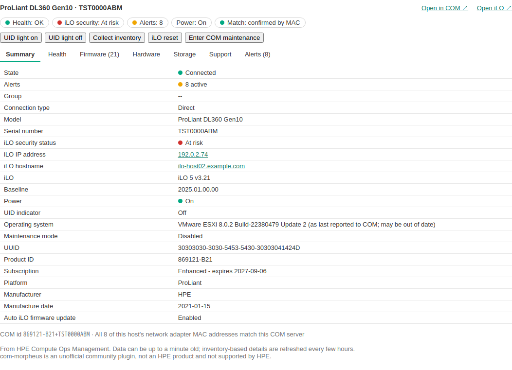
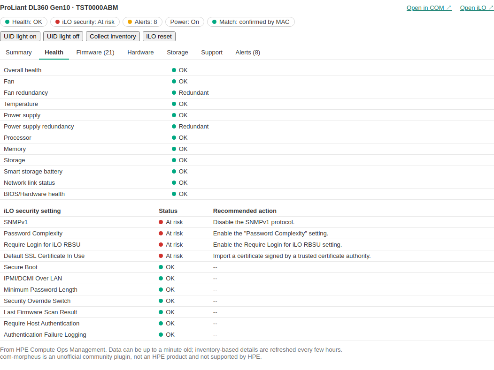
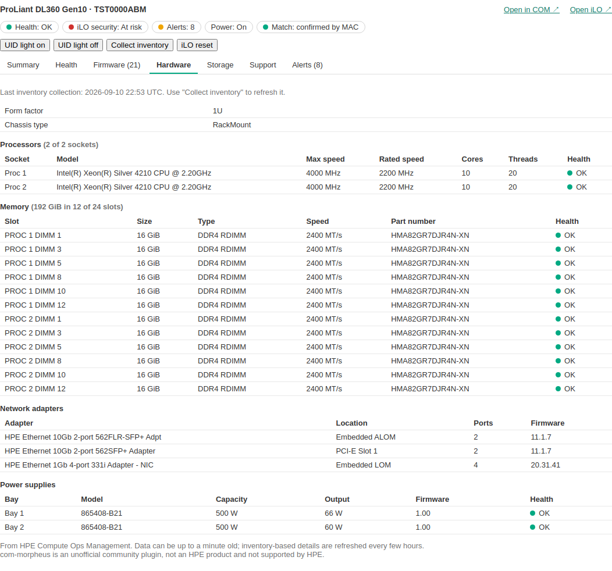
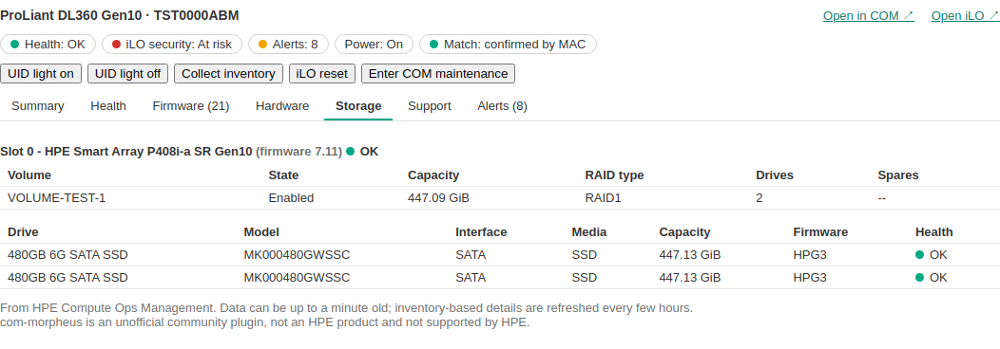

# com-morpheus-plugin

> **Unofficial community project.** Not an HPE or Morpheus Data product. Not developed, endorsed or supported by Hewlett Packard Enterprise. Provided as is, without warranty. HPE, HPE GreenLake, Compute Ops Management, Morpheus, VM Essentials, ProLiant and iLO are trademarks of Hewlett Packard Enterprise; see [NOTICE.md](NOTICE.md) for trademarks and for every source this project was built from.

A plugin for **HPE Morpheus** (including **HPE VM Essentials**) 9.0 and 9.1. It adds an **HPE COM** tab to the page of each physical HPE server host. The tab shows that server as **HPE Compute Ops Management (COM)** sees it, so you don't have to switch consoles: health, firmware, hardware, storage, support and alerts. Optional buttons run a few safe COM jobs.



*Screenshots are rendered from anonymised test data.*

## What it does (0.2.0)

- **Appears only where it makes sense:** on hypervisor hosts whose hardware vendor is HPE and that aren't virtual machines.
- **Finds the matching COM server automatically.** Morpheus already stores each host's factory network-adapter MAC addresses, and COM's inventory lists the same adapters. The plugin matches them, so it never needs access to the host itself. For special cases, a `com-serial=<serial>` or `com-id=<COM id>` tag on the host overrides the match.
- **Mirrors the COM server page in seven sub-tabs:**
  - **Summary:** state, model, serial, iLO, baseline, power, subscription and more.
  - **Health:** every component, plus iLO security settings with COM's recommended actions.
  - **Firmware:** every component and version.
  - **Hardware:** processors, memory, network adapters and power supplies.
  - **Storage:** volumes and drives.
  - **Support:** warranty and contract.
  - **Alerts:** active alerts.
- **Links:**
  - **Open in COM** goes to the server's page in COM.
  - **Open iLO** goes to the iLO's address, as COM's own Remote console link does.
- **Optional action buttons:** UID light on/off, Collect inventory and iLO reset, run as COM jobs with live progress. See [Why these actions](#why-these-actions) and [Security](#security).

| Health | Hardware | Storage |
|---|---|---|
|  |  |  |

## Why these actions

The action set is small on purpose. Each button **restores, observes or refreshes**. None of them **reconfigures**. Nothing here changes BIOS, iLO or storage settings, flashes firmware, or touches the host's power. That keeps the riskiest class of remote change, configuration drift you didn't intend, out of a one-click UI. You still get direct, auditable control of the resources most likely to need a nudge.

### iLO reset: restore without reconfigure

The iLO is the server's independent management brain. It sits beside the host and is used for monitoring, remote console, Redfish, and the link to Compute Ops Management. Like any embedded controller, it can occasionally become sluggish or unresponsive: the web UI stops loading, remote console sessions hang, or COM reports the server as disconnected. A reset is the controller's equivalent of "turn it off and on again", and it's almost ideal for a one-click action:

- **It changes nothing, it restores.** The iLO restarts with exactly the settings, users, certificates and licences it had. No configuration is written, so there's nothing to review, roll back or drift.
- **The workload is left alone.** Only the management controller restarts. The hypervisor host keeps running, and so do its VMs and storage. The only interruption is to management, for a minute or two: the iLO web UI, open remote console sessions and COM's connection. All of them come back on their own.
- **It's a small, predictable blast radius.** One server's controller, one well-understood outcome, and repeating it is harmless.
- **It goes through the front door.** The reset is a COM job under the same governed identity as everything else. It's recorded in COM, and in Morpheus with the user who asked for it. It needs no iLO credentials in Morpheus and no network path from a browser to the iLO.
- **It shortens the path to recovery.** The person looking at a misbehaving host in Morpheus can bring its management plane back without switching consoles or raising a ticket. For anything deeper, **Open in COM** and **Open iLO** are one click away.

It still asks for confirmation first, because a reset briefly drops the management connection.

### UID light and Collect inventory

- **UID light on/off** turns the blue locator LED on the chassis on or off. It's the safest possible action, and it answers the most practical data-centre question: *which box is it?*
- **Collect inventory** asks COM to refresh what it knows about the server. Hardware, storage and network adapters are re-read, so the Hardware and Storage sub-tabs and the MAC matching reflect reality after a change, such as a replaced DIMM or NIC.

### What's deliberately left out

Power on, power off, restart, firmware updates and configuration changes are **not** in this version. They can affect the host and its virtual machines, and they deserve stronger safeguards than a button. For example, power actions should be allowed only when the Morpheus host is in maintenance mode with no running VMs. Firmware updates are better done in COM itself, where baselines and reboot policies are managed.

*This selection reflects the current version and may change as the plugin gains further functions.*

## Requirements

- HPE Morpheus or HPE VM Essentials **9.0.x or 9.1.x**.
- HPE servers onboarded in an **HPE GreenLake** workspace with **Compute Ops Management**.
- A GreenLake **API client** for Compute Ops Management. Ideally it belongs to a dedicated GreenLake account, because the plugin acts as that account (see [Security](#security)).
  - A view-only COM role is enough for the tab.
  - The action buttons need a COM role that can run server jobs.
- Outbound HTTPS from the Morpheus appliance to `sso.common.cloud.hpe.com` and `<region>.api.greenlake.hpe.com`. A proxy is supported.

## Download

Use the prebuilt jar from the [Releases](../../releases) page. There's no need to build anything.

**One jar, `com-morpheus-plugin-<version>.jar`, works on Morpheus / VM Essentials 9.0.x and 9.1.x.** It's compiled against the oldest supported Plugin API (1.4.1, Morpheus 9.0), and its whole test suite also runs against Plugin API 1.5.0 (Morpheus 9.1). Before each release, `tools/check-plugin-core.sh` checks HPE's published plugin sources and docs for any compatibility change.

Each release includes `SHA256SUMS`. Check the download with `sha256sum -c SHA256SUMS`.

Then follow **[docs/INSTALL.md](docs/INSTALL.md)**: create the COM API client, upload the jar, enter the settings, and grant the permissions.

## Security

### Who acts in COM: one shared identity

The plugin uses **one GreenLake API client for the whole Morpheus appliance**: every tenant, host and user. It's set once in the plugin settings. A GreenLake *personal* API client **inherits the roles of the GreenLake user who created it**. So:

- **Everything the plugin does in COM runs as that GreenLake user.** That covers reading data and every action button, whichever Morpheus user clicked. COM's activity log shows that identity, not the Morpheus user.
- **The client can reach whatever that user's COM role allows,** usually the whole workspace. The Morpheus tenant check below limits which hosts a Morpheus user can pick. It doesn't limit what the client could do in COM.
- **The Morpheus permission is the only per-user control.** Who may press the buttons is decided entirely by **com-morpheus: Run HPE COM actions** in Morpheus. Morpheus's log is the only record of which Morpheus user started each job.
- **The client depends on its owner.** If that GreenLake user leaves or loses access, the plugin stops working. Until then, their name is on every action in COM.

**Therefore:**
1. Create the API client under a **dedicated GreenLake account** (a service or shared admin account under your organisation's rules), not a person's own account.
2. Give that account the **smallest COM role** that works: view-only while **Enable actions** is off; an operator role only if you turn actions on. Limit it to the relevant servers if your workspace supports scoped access.
3. Grant **Run HPE COM actions** only to roles you would trust with that account.
4. Keep Morpheus's log, which ties each job to a Morpheus user.

### Safeguards in the plugin

- **Credentials stay on the appliance.** Only the Morpheus appliance talks to GreenLake. The API client secret is stored with the plugin settings and is never sent to browsers.
- **Read-only by default.** The action buttons are off until an administrator turns on **Enable actions**. Even then, they appear only for roles granted **com-morpheus: Run HPE COM actions** at full access.
- **Every action request is re-checked on the appliance:**
  - it must be a POST carrying Morpheus's CSRF token;
  - actions must be turned on, and the user must have full access;
  - the user's tenant must own the host;
  - the host's COM server is found again from Morpheus data, never from the browser;
  - only confirmed matches qualify, never "probable" ones;
  - job progress is shown only for that server's jobs.
- **No commands on hosts.** The plugin never runs anything on hypervisor hosts. Actions are COM jobs only, and each one is logged with the Morpheus user who started it.
- **No power actions.** Power on, off and restart aren't in this version.

## How it works

```
Browser ── Morpheus host page ── "HPE COM" tab (rendered on the Morpheus appliance)
                                   │
                         com-morpheus plugin
                           ├─ MAC index: COM server list + each server's inventory MACs
                           │    (built in the background, kept 6 h)
                           ├─ matches the host's stored MACs to one COM server
                           ├─ fetches that server, alerts, iLO security, warranty, baseline, group, inventory
                           └─ action routes /plugin/comMorpheus/{caps,action,job} (POST, permission-checked)
                                   │  HTTPS, OAuth2 client credentials
                                   ▼
                     HPE GreenLake COM API  (<region>.api.greenlake.hpe.com)
```

The source is commented throughout: `ComService` (matching and actions), `ComClient` (COM API), `ComController` (routes), `ComView` / `ComInventoryView` (what the tab shows).

## Build from source (optional)

You need only Docker; the build runs in a JDK 17 container.

```bash
tools/build.sh
```

This builds and tests the jar into `dist/`, then repeats the test suite against the newer Plugin API (1.5.0). A first build downloads Gradle and its dependencies; later builds take a few minutes.

Optional checks (opt-in, off by default):
- `COM_MOCK=1` runs the real HTTP client against HPE's public COM mock server (`LiveChecksSpec`).
- `PREVIEW_OUT=<dir>` renders the tab to HTML for review (`LiveChecksSpec`).
- `LOAD_JARS=<jar>[,<jar>…]` loads built jars through the plugin API's own `PluginManager.registerPlugin` (`PluginLoadSpec`). Use a renamed build, because the loader is parent-first.

## Limits

- One COM workspace and region per Morpheus appliance.
- The COM web UI address is confirmed for US West (`us-west2.compute.cloud.hpe.com`). EU Central and AP Northeast follow the same pattern but are unverified; the **COM web UI URL** setting overrides it.
- Supported: Morpheus / VM Essentials 9.0.x and 9.1.x. A new Morpheus release with a new Plugin API is checked with `tools/check-plugin-core.sh` and the compatibility test run before it's listed as supported.

## Contributing

**Pull requests are welcome.** External development is how plugins like this get better. See **[CONTRIBUTING.md](CONTRIBUTING.md)** for how to build, test and submit changes. Use the [issue templates](../../issues/new/choose) for bugs and ideas, and report security problems privately.

## Sources, attribution and trademarks

This plugin was written from scratch, using HPE's public documentation and the Morpheus plugin API as references. **[NOTICE.md](NOTICE.md)** lists every source, its licence and exactly how it was used, plus the trademark notices.

## License

[MIT](LICENSE) for this project's own code. The Morpheus plugin API it compiles against is licensed separately by Morpheus Data, LLC and isn't included.
