# Installing com-morpheus-plugin

> Unofficial community plugin, not an HPE product and not supported by HPE. See [NOTICE.md](../NOTICE.md).

This guide assumes you've never installed a Morpheus plugin or created a GreenLake API client before. Every step says where to click and what you should see. Allow about 20 minutes.

*The screenshots are from a real Morpheus 9.0.1 appliance and GreenLake workspace. Names, addresses and ids are replaced with example values, and each example value means the same thing everywhere in this guide and the README:*

| In the examples | Example value |
|---|---|
| GreenLake workspace | `my-workspace`, workspace ID `4f2a9c7e1b8d4e6fa3c5d7e9b1f20a64` |
| API client ID | `7c3e8a12-5b4f-4d9e-a6c1-2f8b0d4e9a37` |
| Morpheus appliance | `morpheus.example.com`, signed in as `admin` (shown as **Admin User**) |
| Cloud, cluster and site tag | `cloud-a`, `cluster-a`, `site-a` |
| Hosts and their serial numbers | `host-a`, `host-b`, `host-c`; `XYZ0000001`, `XYZ0000002`, `XYZ0000003` |
| host-a's iLO | `192.0.2.21`, `ilo-host-a.example.com` |
| COM region | US West (`us-west`) |

## Before you start

You need:

- **Morpheus admin access.** HPE Morpheus or HPE VM Essentials **9.0.x or 9.1.x**, and a login that can open **Administration → Integrations → Plugins**.
- **Access to your HPE GreenLake workspace**, the one where your HPE servers are onboarded in **Compute Ops Management** (COM), with permission to create API clients.
- **Network access from the Morpheus appliance** (the manager, not your laptop) to these addresses on port 443:
  - `<region>.api.greenlake.hpe.com` (for example `us-west.api.greenlake.hpe.com`)
  - `global.api.greenlake.hpe.com`
  - `sso.common.cloud.hpe.com`

  If the appliance reaches the internet through a proxy, have its address ready (for example `http://proxy.example.com:3128`).

Not sure which region your servers are in? On the GreenLake home page, **My services** lists **Compute Ops Management** under its region: **US West**, **EU Central** or **AP Northeast**. That gives the address: `us-west`, `eu-central` or `ap-northeast`.

## 1. Find your GreenLake workspace ID

The workspace ID tells GreenLake which workspace the plugin's sign-in is for. With it, the plugin signs in through your workspace's own sign-in address first, which some HPE GreenLake services require since October 2026.

1. Sign in to [HPE GreenLake](https://common.cloud.hpe.com) and switch to the workspace that holds your servers (the workspace name is at the top left, next to the GreenLake logo).
2. Open the menu (the ☰ icon at the top left), then **IAM and administration → Workspace details**.

   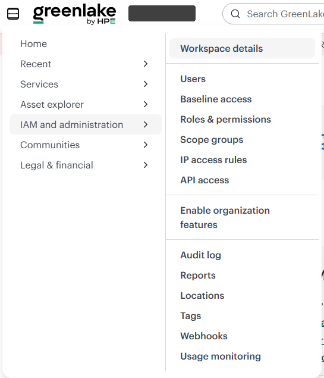

3. Copy the **Workspace ID**. It's 32 letters and digits, like `4f2a9c7e1b8d4e6fa3c5d7e9b1f20a64` in the example below. Paste it into a note for step 4.

   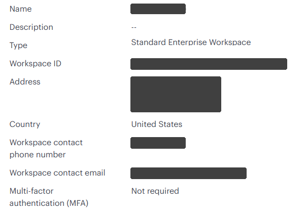

## 2. Create an API client (GreenLake)

> **The plugin acts in COM as the GreenLake user who creates this API client,** for everyone on the Morpheus appliance. A personal API client has exactly its creator's permissions, at the time it's used, and COM's log shows that user for every read and every action. Use a **dedicated account** (a service or shared admin account under your organization's rules) with the **smallest COM role that works**: a view-only role if you'll leave the action buttons off, or a role that can run server jobs (for example Operator) if you'll turn them on. See [Security](../README.md#security).

1. Sign in to GreenLake as that dedicated account, in the same workspace.
2. Open the menu, then **IAM and administration → API access**, and click **Create personal API client**.

   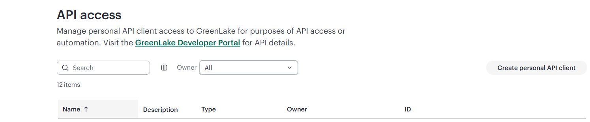

3. **Name:** something you'll recognize later, for example `Morpheus-API-Client`.
4. **Service:** choose **GreenLake platform and most services**. Compute Ops Management uses the same sign-in as the platform.

   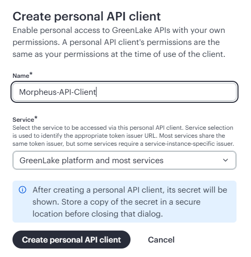

5. Click **Create personal API client**. GreenLake now shows the **Issuer URL**, the **Client ID** and the **Secret**. Copy the client ID and the secret into your note. In the example below, the client ID is `7c3e8a12-5b4f-4d9e-a6c1-2f8b0d4e9a37`.

   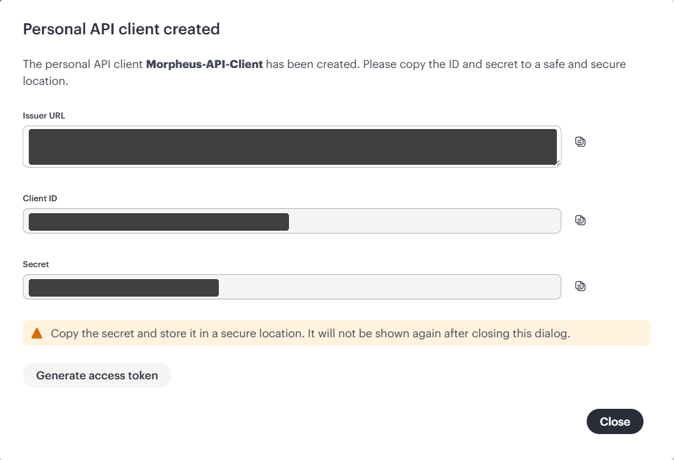

   - **The secret is shown only once.** If you lose it, create a new client.
   - The **Issuer URL** ends in `/oauth2/<workspace ID>/token`: that's the same workspace ID as in step 1 (`4f2a9c7e1b8d4e6fa3c5d7e9b1f20a64` in the examples), a handy way to double-check it.
   - You don't need **Generate access token**: the plugin makes its own tokens.

## 3. Upload the plugin (Morpheus)

1. Download `com-morpheus-plugin-<version>.jar` and `SHA256SUMS` from the [Releases](https://github.com/grahamfairbank/com-morpheus-plugin/releases) page. The same jar works on Morpheus 9.0.x and 9.1.x.
2. Optional but recommended: check the download. In a terminal in the download folder, run `sha256sum -c SHA256SUMS` (Linux and macOS) or `certutil -hashfile com-morpheus-plugin-<version>.jar SHA256` (Windows) and compare it with the value in `SHA256SUMS`.
3. In Morpheus, go to **Administration → Integrations → Plugins** and click **+ Add Plugin**.
4. Choose the jar and click **Upload**.

   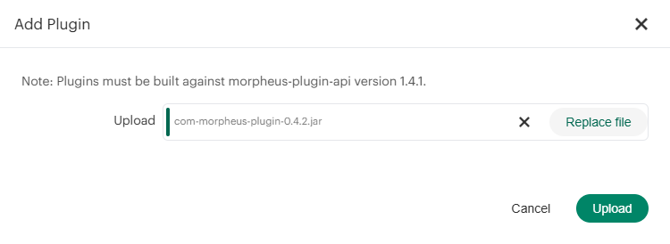

5. After a few seconds, **com-morpheus** appears in the plugin list, with the version you uploaded and a check mark under **Enabled**.

   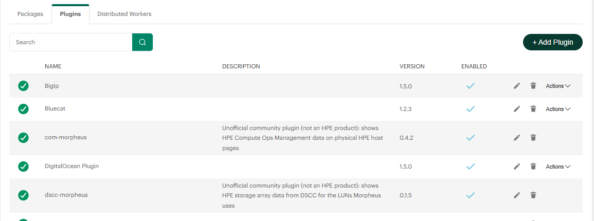

**Upgrading:** upload the new jar the same way. Your settings are kept. **Removing:** delete the plugin from the same list. It leaves nothing behind in Morpheus, on hosts or in COM.

## 4. Enter the settings

1. In **Administration → Integrations → Plugins**, click the pencil icon on the **com-morpheus** row. The **Edit Plugin** window opens.
2. Fill in:

| Setting | What to enter |
|---|---|
| COM API region URL | `https://us-west.api.greenlake.hpe.com`, `https://eu-central.api.greenlake.hpe.com` or `https://ap-northeast.api.greenlake.hpe.com` (from "Before you start") |
| API client ID | from step 2 (`7c3e8a12-5b4f-4d9e-a6c1-2f8b0d4e9a37` in the examples) |
| API client secret | from step 2 |
| GreenLake workspace ID | from step 1 (`4f2a9c7e1b8d4e6fa3c5d7e9b1f20a64` in the examples) |
| Token URL override | leave blank |
| MSP tenant ID (Tenant-Acid) | leave blank, unless you use an MSP workspace |
| COM web UI URL | leave blank (set it only if **Open in COM** opens the wrong region) |
| HTTP proxy for GreenLake | blank, or `http://proxy.example.com:3128` if the appliance needs a proxy (no proxy authentication) |
| Only show to roles with the com-morpheus permission | off: everyone who can see a host or cluster sees its tab. On: only roles granted the permission in step 5. |
| Enable actions | off: the tab is read-only. On: roles with **Run HPE COM actions** see the buttons (UID light, Collect inventory, iLO reset, COM maintenance). See [Why these actions](../README.md#why-these-actions). |
| Show the tab on non-HPE hosts | off. Turn it on only for troubleshooting. |
| Show plugin route diagnostics | off. Turn it on only for troubleshooting. |

3. Click **Save Changes**.

   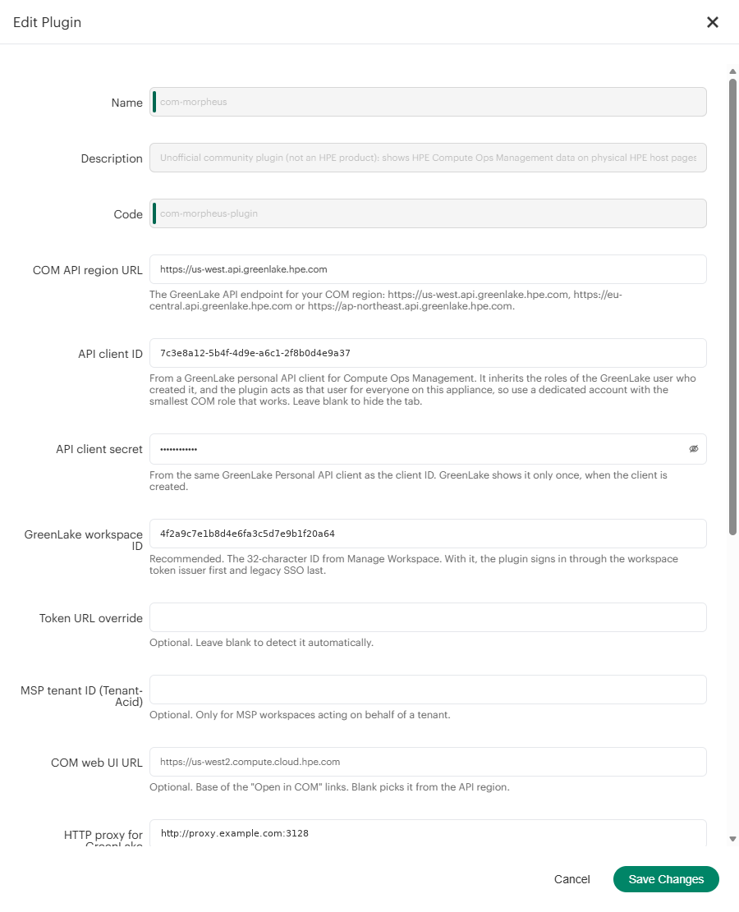

## 5. Permissions

The plugin adds two permissions to every Morpheus role:

| Permission | Levels | Grants |
|---|---|---|
| **com-morpheus: View HPE COM tab** | None / Read | Seeing the tabs, when "Only show to roles with the com-morpheus permission" is on. |
| **com-morpheus: Run HPE COM actions** | None / Full | The action buttons, when **Enable actions** is on. Anyone with it acts in COM **as the API client's GreenLake account**, so grant it only to people you'd trust with that account. |

You can set them by hand: **Administration → Roles → (role)**, search the permissions for `com`, and choose the level. Or let the script in step 6 make a ready-made role.

## 6. Optional: a ready-made role (and user) for the HPE COM tabs

People who look after hardware often need the HPE COM tabs, and maybe the buttons, without being able to change anything else in Morpheus. Making that role by hand means opening the role editor and setting each feature permission, one dropdown at a time, so they can open the host and cluster pages but nothing more. That's well over a hundred clicks, it's easy to miss one (or give one too many), and you'd repeat it on every appliance.

[`tools/create-com-user.py`](../tools/create-com-user.py) does it for you in about a minute.

**What you need:** Python 3.8 or later on any computer that can reach the Morpheus appliance (your laptop is fine; on Windows, install Python from python.org and use `py` instead of `python3`). Nothing else: it uses only Python's standard library.

**Run it:**

1. Download [`tools/create-com-user.py`](../tools/create-com-user.py) from the repository (on GitHub, open the file and choose **Download raw file**).
2. In a terminal, in the folder where you saved it, run:

   ```bash
   python3 create-com-user.py morpheus.example.com
   ```

   Use your appliance's host name or IP address in place of `morpheus.example.com`.

3. Answer the prompts:
   - **Certificate:** if the appliance uses a self-signed certificate, the script shows its fingerprint and asks whether to trust it for this run. Compare it with the appliance's certificate if you can, then answer `y`.
   - **Admin username and password:** an administrator login, used only for this run. The password isn't shown as you type.
   - **1 or 2:** `1` for a role that can only view the HPE COM tabs; `2` for a role that can also run the actions. People with option 2 act in COM as the plugin's GreenLake API client.
   - **Name for the new role:** press Enter for `hpe-com-viewer` (option 1) or `hpe-com-operator` (option 2), or type your own.
   - **Create a new user with this role now?** `y` to make one (username, email, first and last name, password; Morpheus requires an email, and any address you control will do), or `n` to give the role to existing users yourself.
4. The script then:
   - creates the role and sets **Read** on the five pages the tabs need, and nothing else: **Operations: Dashboard** (the landing page) and **Infrastructure: Compute, Clusters, Groups** and **Clouds**;
   - sets **com-morpheus: View HPE COM tab** to **Read**, and **Run HPE COM actions** to **Full** (option 2) or **None** (option 1);
   - leaves **every other permission at None**, including logs, health, tasks, templates, Terraform state, integrations and settings, as well as credentials, users and roles;
   - gives the role read access to all groups and clouds;
   - **reads the role back and checks it.** If any other permission is above None, it stops before creating a user and tells you what to review;
   - creates the user, if you asked for one;
   - deletes the admin token it used, where your Morpheus version allows.

At the end it lists what it granted, for example `Read: Operations: Dashboard, Infrastructure: Compute, Infrastructure: Clusters, Infrastructure: Groups, Infrastructure: Clouds`. If your Morpheus version doesn't have one of those permissions, it says so and leaves it out.

**About the messages:**
- *could not remove this run's admin token:* the admin login token the script used couldn't be deleted on this version. It expires on its own; nothing else is left behind.

The role it creates, in **Administration → Roles**, searched for `com`: **Compute** is **Read**, **View HPE COM tab** is **Read** and **Run HPE COM actions** is **Full**. Searched for `com`, the role looks the same with every version of the script:

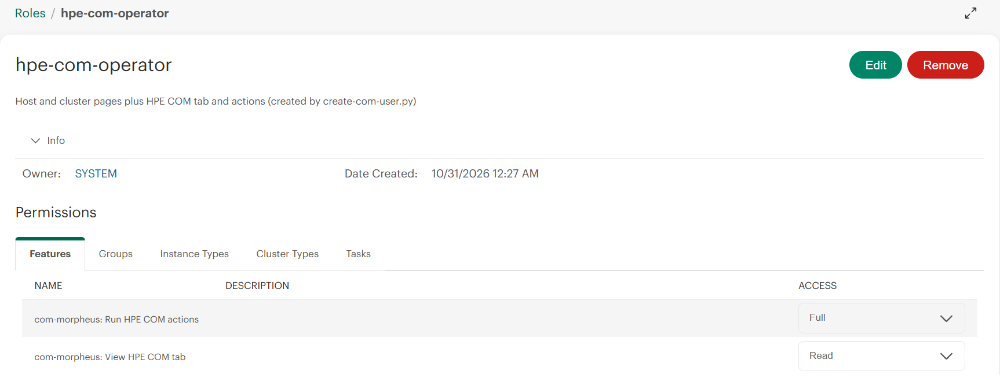

Give the username and password to the person who needs it. They sign in to Morpheus as usual and see the HPE COM tabs (and, with option 2 and **Enable actions** on, the buttons). To give the role to existing users instead: **Administration → Users → (user) → Edit → Roles**.

**What it leaves behind:** the new role and, if you asked for one, the new user. Nothing else: it writes no files, keeps no logs and never echoes passwords. To undo it, delete the user and the role in **Administration → Users** and **Administration → Roles**. If the script says the appliance has no com-morpheus permissions, the plugin isn't installed or is disabled: finish step 3 first.

**Options:** `--port <n>` if the appliance doesn't use 443.

## 7. Check it

1. Open a physical HPE host: **Infrastructure → Compute → (host)**. Morpheus puts extra tabs under the **▼** menu at the right end of the tab row, so look there for **HPE COM**.

   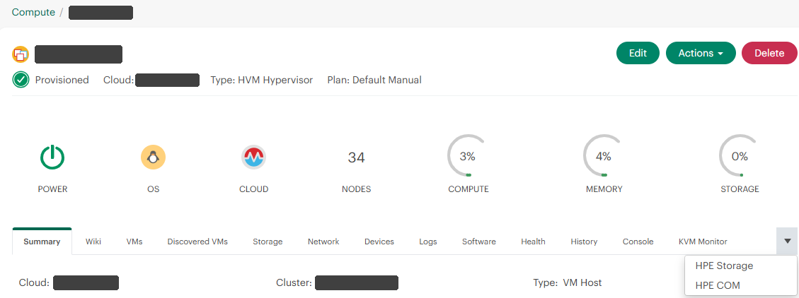

2. The very first time (and after Morpheus or the plugin restarts) the tab says it's **matching hosts to HPE Compute Ops Management**. It reads the COM server list and each server's inventory, which takes up to a minute. Open the tab again.

   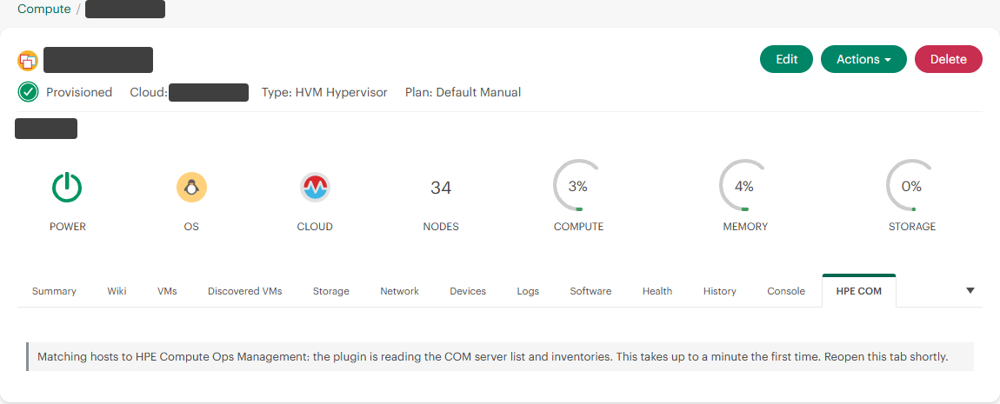

3. You should see the server as COM sees it, with **Match: confirmed by MAC**, and the seven sub-tabs: Summary, Health, Firmware, Hardware, Storage, Support and Alerts.

   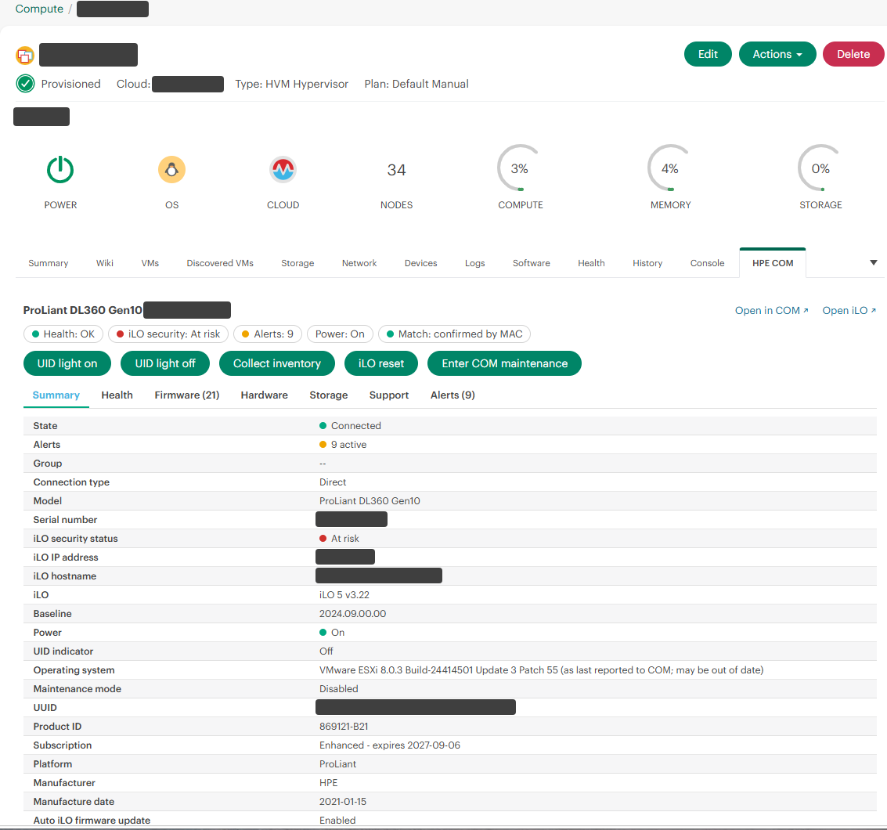

4. If **Enable actions** is on and your role has **Run HPE COM actions**, the buttons appear above the sub-tabs (reload the page after changing the setting). Try **UID light on** first: it only lights the blue locator LED on the server, and the status beside the buttons follows the COM job until it's done. The Summary sub-tab's **UID indicator** then reads **On**. **UID light off** turns it off again.
5. Open a cluster: **Infrastructure → Clusters → (cluster)**, then its **HPE COM** tab. It lists every host in the cluster with its COM match, health, power, active alerts, support state and COM maintenance mode, with totals at the top.

   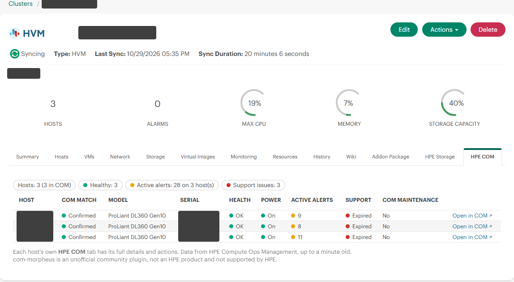

How the pieces fit together is shown in the [How it works](../README.md#how-it-works) infographic.

## Troubleshooting

| The tab says | Meaning / fix |
|---|---|
| Couldn't sign in to GreenLake (HTTP 401) | Wrong client ID or secret, or the client was deleted: create a new one (step 2). Check the workspace ID too (step 1). |
| Host tab: "Couldn't load HPE Compute Ops Management data. COM /v1/servers/…: HTTP 500" | COM's single-server read failing (seen October 29, 2026). Upgrade to 0.4.2, which tries COM's other published path and otherwise shows the server-list data with a note. |
| Couldn't reach COM | The appliance can't reach GreenLake: check DNS and the firewall (see "Before you start"), or set the HTTP proxy. |
| No HPE COM tab on a host | Look under the **▼** menu at the right end of the tab row. The tab appears only on hypervisor hosts whose hardware vendor is HPE. Turn on "Show the tab on non-HPE hosts" to see what the plugin sees. |
| rate limited by COM | GreenLake throttled the client. Wait the time shown; the plugin caches to keep calls low. |
| No matching server | None of the host's MACs are in COM's inventory: the server isn't onboarded in this workspace, or its inventory is old. Add `com-serial=<serial>` as a tag on the host (for example `com-serial=XYZ0000001` on host-a). |
| more than one COM server | Shared or moved NICs. Add `com-serial=<serial>` to the host. |
| Match: probable | Only some MACs match (a replaced NIC, or a stale COM inventory). Confirm with `com-serial=<serial>` (actions then work if at least one MAC matches that server and none match another), or run an inventory collection in COM. |
| "Actions on a tag-matched host need the tag to agree with the host's hardware" | The `com-serial` / `com-id` tag names a server whose inventory has none of this host's MACs, or another server has some of them. Collect inventory in COM, or correct or remove the tag. |
| "Request refused: cross-origin" | The browser's Origin doesn't match the appliance's host name as the plugin sees it. This happens behind a reverse proxy that rewrites `Host` without sending `X-Forwarded-Host`. Configure the proxy to pass the original `Host`, or `X-Forwarded-Host`. |
| "Request refused: missing X-Requested-With header" | The request didn't come from the plugin's own script (for example, a hand-made API call or a proxy stripping headers). Use the buttons in the tab. |
| "Request refused: reopen the HPE COM tab and try again" | The tab's action token is from before the plugin was reloaded or upgraded. Reopen the tab. |
| "An action was started on this server less than 30 seconds ago" | One action per server every 30 seconds. Wait for the running job to finish. |
| Cluster tab says "Couldn't load alerts: COM /v1/alerts: HTTP 400" | Seen with 0.4.0 on some COM workspaces. Upgrade to 0.4.1 or later, which reads alerts per server instead; see [Known issues](../README.md#known-issues). |
| No action buttons | Check that **Enable actions** is on, that your role has **Run HPE COM actions** at **Full**, and that you have reloaded the page. |
| "the API client needs a COM role that can run server jobs (HTTP 403)" | The COM API client is read-only. Give it an operator role in GreenLake. |
| "Upload: nothing happens" / "Failed to parse plugin file" | A corrupt or incomplete download: check it with `SHA256SUMS`. The upload's exact reason is in the browser's developer tools (Network → the upload request's response) and in the Morpheus log. |

The plugin logs to the Morpheus application log (`/var/log/morpheus/morpheus-ui/current`, or **Administration → Health → Morpheus Logs**) with the prefix `com-morpheus:`. Every action records the Morpheus user, the host and the COM job id.
